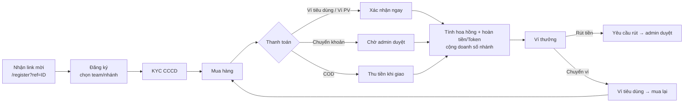
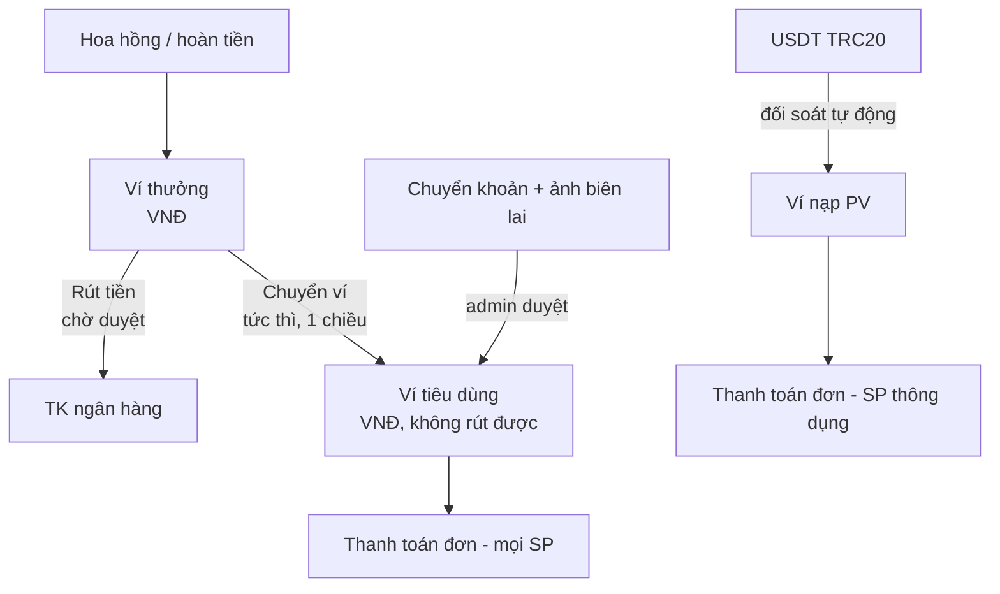
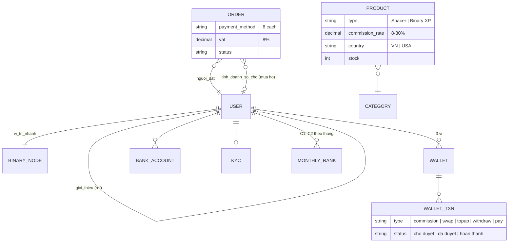

# Phân tích luồng hoạt động Shoplife (shoplife.vn)

> Khảo sát ngày 10/11/2026, bằng một tài khoản đã đăng nhập (cấp Đại lý, đã KYC).
> Chỉ xem giao diện, không đặt đơn, không gửi yêu cầu rút/nạp/chuyển ví.
> Dữ liệu cá nhân của tài khoản (tên, SĐT, số tài khoản, Binary ID) đã được lược bỏ.
> Những điểm ghi **(suy luận)** là phỏng đoán từ giao diện, chưa kiểm chứng được.

---

## 1. Tổng quan

Shoplife là một web app dạng mobile (tự gọi là "Shoplife DAPP v2.1.0 • BINARY ECOSYSTEM"), gồm 3 phần gắn chặt với nhau:

1. **Sàn bán hàng**: listing sản phẩm theo nhóm, mỗi sản phẩm hiện **tỉ lệ hoa hồng riêng**.
2. **Hệ thống ví nhiều lớp**: Ví thưởng, Ví tiêu dùng, Ví nạp PV (+ đơn vị nội bộ PV, Token).
3. **Mạng lưới nhị phân (binary)**: link mời đăng ký có chọn team (nhánh), cấp bậc C1/C2… xét theo tháng, hoa hồng có trần ("hoa hồng tối đa").

### Thanh điều hướng chính (bottom nav)

| Tab | URL | Chức năng |
|---|---|---|
| Trang chủ | `/home` | Listing, tìm kiếm, lọc, giỏ hàng, đổi ngôn ngữ |
| Ví | `/home/wallets` | 3 ví, rút tiền, chuyển ví, nạp tiền, nạp PV, TK ngân hàng |
| Đội nhóm | `/home/affiliate` | Cấp bậc, số thành viên, hoa hồng đã nhận/có thể nhận, link mời |
| Tài khoản | `/home/profile` | Hồ sơ, cấp bậc, điều kiện lên cấp, KYC, địa chỉ, bảo mật 2FA |

### Sitemap quan sát được

```
/home                          Trang chủ (listing)
/home/products/detail?id=…     Chi tiết sản phẩm
/home/cart                     Giỏ hàng
/home/checkout                 Thanh toán
/home/wallets                  Ví
/home/wallets/swaps            Lịch sử chuyển ví thưởng → ví tiêu dùng
/home/affiliate                Đội nhóm
/home/profile                  Tài khoản
/home/profile/kyc              Xác minh danh tính
/register?ref=<BinaryID>       Đăng ký qua link mời (chọn team tại trang này)
```

---

## 2. Các khái niệm cốt lõi

| Khái niệm | Ý nghĩa quan sát được |
|---|---|
| **Binary ID** | Mã định danh thành viên, đồng thời là mã giới thiệu (`?ref=`) và **nội dung chuyển khoản** khi thanh toán |
| **PV** | Đơn vị điểm nội bộ. Từ checkout suy ra **1 PV ≈ 25.000đ** (75.600đ ≈ 3,024 PV). Hoa hồng tháng hiển thị theo PV |
| **Token** | Phần thưởng hoàn lại khi mua (VD "Hoàn tiền 2% + 0.5 Token") |
| **Nhãn thành viên** | VD "ĐẠI LÝ" – cấp liên kết, quyết định mức hoàn tiền khi mua |
| **Cấp bậc (rank)** | C1, C2… xét **theo tháng**, điều kiện dựa trên cấp của F1 (VD lên C2 cần 3 F1 đạt C1) |
| **Loại sản phẩm** | Mỗi thẻ SP có nhãn **"Spacer"** hoặc **"Binary XP"** (suy luận: Binary XP = SP tính doanh số nhị phân; Spacer = SP thường/không tính nhánh) |
| **Nhóm SP** | SP. Chiến lược / SP. Tổng hợp / Gia dụng; lọc thêm theo quốc gia (Vietnam / USA) |
| **Tỉ lệ hoa hồng theo SP** | Mỗi sản phẩm một tỉ lệ riêng: 8%, 10%, 15%, 25%, 30% |
| **Hoa hồng tối đa (trần)** | "Đã nhận X / Có thể nhận Y" – thành viên chỉ được nhận hoa hồng tới một trần |
| **Tái tiêu dùng** | Đếm số lần và tổng tiền mua lại (VD 18 lần) – (suy luận) dùng để nâng trần hoa hồng |

---

## 3. Luồng tổng thể



Điểm then chốt: tiền thưởng **có thể quay vòng ngay vào mua hàng** (Ví thưởng → Ví tiêu dùng → mua lại), tạo vòng "tái tiêu dùng".

---

## 4. Chi tiết từng luồng

### 4.1 Đăng ký qua link mời

- Mỗi thành viên có link `https://shoplife.vn/register?ref=<BinaryID>` + mã QR, nút sao chép.
- Ghi chú trên giao diện: **"Link mời đăng ký (chọn team tại trang đăng ký)"** → người đăng ký chọn team/nhánh (suy luận: nhánh trái/phải của cây nhị phân).
- Đang đăng nhập thì truy cập link đăng ký sẽ bị chuyển về `/home` (không xem được form đăng ký).

### 4.2 KYC

- Trang `/home/profile/kyc`. Thông điệp: "Xác minh danh tính của bạn qua KYC để sử dụng đầy đủ tính năng".
- Khi đã duyệt: hiển thị "Đã xác minh danh tính" + huy hiệu "Xác thực" cạnh tên.
- (Suy luận) KYC là điều kiện để rút tiền.

### 4.3 Duyệt và chọn sản phẩm

**Trang chủ**
- Ô tìm kiếm, icon giỏ hàng (có badge số lượng), chọn ngôn ngữ (VI).
- Tab nhóm SP: SP.Chiến lược / SP. Tổng Hợp / Gia Dụng. Hiện "N items found".
- Bộ lọc: **Quốc gia** (Vietnam, USA) + **Loại sản phẩm**.

**Thẻ sản phẩm** gồm: ảnh, tên, nhãn loại (Spacer/Binary XP), lượt bán, giá, nút "+" thêm nhanh, tồn kho ("Còn 46 sản phẩm" / "Hết hàng"), **"Tỉ lệ hoa hồng X%"**.

**Chi tiết sản phẩm** (`/home/products/detail?id=<uuid>`): giá, tên, đánh giá sao, lượt bán, tồn kho, thương hiệu, xuất xứ, nút **Thêm vào giỏ hàng** / **Mua ngay**, sản phẩm liên quan, nút **Chat ngay**.

### 4.4 Giỏ hàng

- Banner ưu đãi theo cấp: **"Hoàn tiền 2% + 0.5 Token – Cấp độ liên kết: Đại lý"** + link "Chi tiết" (dẫn sang trang Đội nhóm).
- Danh sách SP có checkbox chọn, đơn vị, tăng/giảm số lượng, xóa, nút "Xóa hết".
- Tạm tính, Tổng thanh toán, nút **Tiến hành thanh toán**.

### 4.5 Checkout

**Bước 1 – Thông tin giao hàng**
- Tên, SĐT, địa chỉ (nút "Thay đổi").
- Tùy chọn **"Mua hộ cho cấp dưới – Đặt hàng và tính doanh số cho tài khoản downline"**: tuyến trên đặt đơn và tính doanh số cho một tài khoản tuyến dưới.

**Bước 2 – Phương thức thanh toán (6 cách)**

| Phương thức | Mô tả trên giao diện | Xác nhận đơn |
|---|---|---|
| Ví Tiêu Dùng | Trả bằng số dư ví tiêu dùng, áp dụng mọi SP. Hiển thị số dư theo PV + VNĐ, báo thiếu bao nhiêu | Ngay |
| Ví Nạp PV | Trả bằng PV, **chỉ áp dụng SP thông dụng**. Hiện số PV cần trả | Ngay |
| Ví Thưởng | Đang "Tạm khóa" | — |
| Chuyển Khoản | Số tiền (VNĐ + quy đổi PV), STK công ty, **QR có sẵn số tiền + nội dung**, nội dung CK = **Binary ID** | Chờ admin duyệt |
| USDT (TRC20) | Hiện báo tạm không khả dụng | — |
| Ship COD | Trả tiền mặt khi nhận | Khi giao |

**Bước 3 – Chi tiết thanh toán**: Tiền hàng + **Thuế VAT 8%** = Tổng thanh toán → nút **Đặt hàng**.

> Lưu ý: nội dung chuyển khoản là Binary ID chứ không phải mã đơn, nên admin phải duyệt tay để ghép tiền với đơn.

### 4.6 Ví (3 ví + tài khoản ngân hàng)



| Ví | Nguồn tiền vào | Dùng để | Quy tắc |
|---|---|---|---|
| **Ví thưởng** | Hoa hồng, thưởng | Rút về ngân hàng, hoặc chuyển sang ví tiêu dùng | Rút: nhập số tiền (nút Max), chọn TK ngân hàng, ghi chú → trạng thái **Chờ duyệt / Đã duyệt**, kênh "BANKING" |
| **Ví tiêu dùng** | Chuyển từ ví thưởng; nạp bằng chuyển khoản | Mua hàng | "Chỉ dùng để mua hàng, không rút được". Chuyển từ ví thưởng: **tức thì, không cần duyệt** |
| **Ví nạp PV** | Nạp USDT | Mua SP thông dụng | Nhập số USDT, địa chỉ ví gửi, TxHash (tùy chọn); "hệ thống tự duyệt khi nhận được tiền" |

**Nạp tiền vào ví tiêu dùng**: (1) nhập số tiền → hiện QR, (2) chuyển khoản tới TK công ty, (3) bấm Gửi yêu cầu, có thể đính kèm ảnh biên lai → admin duyệt.

**Tài khoản ngân hàng nhận tiền**: nhiều tài khoản, có tài khoản mặc định; thêm / sửa / xóa.

**Lịch sử**: chuyển ví (`/home/wallets/swaps`: tổng đã chuyển, từng lần, trạng thái HOÀN THÀNH), yêu cầu rút gần đây, hoạt động gần đây.

### 4.7 Đội nhóm (`/home/affiliate`)

- Trạng thái kết nối ví Web3: "Chưa kết nối" (suy luận: kết nối ví crypto cho phần Token).
- Huy hiệu cấp **C1**, "Hoa hồng tháng này: X PV".
- **Người dùng hoạt động**: tổng số thành viên trong mạng, số mới hôm nay.
- **Thông tin hoa hồng**: Đã nhận / Có thể nhận (VNĐ).
- **Công cụ giới thiệu**: link mời + nút copy + mã QR.
- Không thấy cây nhị phân hay danh sách F1 chi tiết trên giao diện.

### 4.8 Tài khoản & cấp bậc (`/home/profile`)

- Ảnh đại diện, tên, huy hiệu Xác thực, Binary ID, nhãn **ĐẠI LÝ**, huy hiệu **C1**.
- **Cấp bậc hiện tại**: "C1 • Tháng 2026-11" → cấp được tính **theo từng tháng**.
- **Điều kiện lên cấp**: VD lên **C2** cần **"F1 đạt C1: 0/3"**; "Số liệu tính theo tháng hiện tại, cập nhật liên tục".
- **Hoa hồng tối đa**: thanh tiến độ "Đã nhận / Trần".
- **Số lần tái tiêu dùng** và **Đã tái tiêu dùng (VNĐ)**.
- Menu: Xác minh danh tính, Chỉnh sửa hồ sơ, Địa chỉ giao hàng, **Bảo mật (2FA, quyền truy cập ví)**, Đăng xuất.

---

## 5. Mô hình dữ liệu suy ra



---

## 6. Áp dụng cho hệ thống Affiliate của mình

So với đặc tả Phase 1 (`Dac-ta-trien-khai-Affiliate-Phase1.html`).

### 6.1 Nên tham khảo

| Ý tưởng từ Shoplife | Áp dụng thế nào | Ưu tiên |
|---|---|---|
| **Tỉ lệ hoa hồng theo từng sản phẩm** hiển thị ngay trên thẻ SP | Thêm trường `commission_rate` trên sản phẩm (hoặc hệ số nhân với tỉ lệ theo cấp). Cần chốt với khách: tỉ lệ theo cấp, theo SP hay kết hợp | Cao, cần hỏi khách |
| **Ví thưởng → Ví tiêu dùng** (chuyển tức thì, 1 chiều) | Cho thành viên dùng hoa hồng để mua hàng ngay, không cần rút. Giảm tải duyệt rút tiền | Trung bình |
| **Thanh toán bằng số dư ví** khi checkout | Đi kèm ý trên: đơn trả bằng ví được xác nhận ngay | Trung bình |
| **Điều kiện lên cấp + thanh tiến độ** trên trang tài khoản | Trang S8 hiển thị "còn thiếu X đ để lên Đại lý" | Cao (đã có trong đặc tả) |
| **Link mời + QR + nút copy** | Đã có trong đặc tả (S8) | Cao |
| **Nhiều TK ngân hàng, có TK mặc định** | Phase 1 giữ 1 STK trùng KYC (chống gian lận); không cần nhiều TK | Không làm |
| **Bảo mật 2FA** cho thao tác ví | Thêm OTP khi rút tiền / đổi STK | Trung bình |
| **Đính kèm ảnh biên lai** khi nạp/chuyển khoản | Dùng làm phương án dự phòng khi webhook không khớp | Thấp |

### 6.2 Mình làm tốt hơn, nên giữ

| Shoplife | Hệ thống mình |
|---|---|
| Nội dung CK = Binary ID → admin **duyệt tay** từng đơn | QR động có **mã đơn** + webhook ngân hàng → **tự xác nhận** |
| Cấp bậc C1/C2 tính lại theo tháng | Cấp theo doanh số cộng dồn, không hạ cấp (đơn giản, dễ hiểu) |

### 6.3 Cần cân nhắc kỹ trước khi áp dụng

| Tính năng | Rủi ro |
|---|---|
| **"Mua hộ cho cấp dưới"** (đặt đơn tính doanh số cho downline) | Có thể bị dùng để đẩy F1 lên cấp, hợp thức hóa doanh số. Nếu làm thì phải ghi rõ người trả tiền và người được tính doanh số |
| **PV, Token, nạp USDT, kết nối ví Web3** | Thanh toán và đổi tài sản số có ràng buộc pháp lý riêng tại Việt Nam; độ phức tạp đối soát cao |
| **Cây nhị phân, chọn team khi đăng ký, rank theo tháng** | Chính là phần KPI "mặt trời + nhị phân" đang hoãn sang Phase 2. Shoplife cho thấy phần này cần: chọn nhánh khi đăng ký, rank theo tháng, điều kiện theo số F1 đạt cấp |
| **Trần hoa hồng ("Có thể nhận") gắn với tái tiêu dùng** | Mô hình "phải mua thêm mới được nhận tiếp" là dấu hiệu nhạy cảm theo quy định về đa cấp (NĐ 137/2026) |

### 6.4 Câu hỏi nên hỏi khách sau khi xem Shoplife

1. Khách có muốn **tỉ lệ hoa hồng theo từng sản phẩm** như Shoplife không, hay giữ theo cấp người hưởng?
2. Có cần **ví tiêu dùng** (dùng hoa hồng để mua hàng) ở Phase 1 không?
3. KPI "mặt trời + nhị phân" có phải giống Shoplife: chọn nhánh lúc đăng ký, rank C1/C2 tính theo tháng, lên cấp dựa trên số F1 đạt cấp?
4. Có cần tính năng **mua hộ cho tuyến dưới** không?
5. Có cần **trần hoa hồng** không?

---

## 7. Phần chưa quan sát được

- Form đăng ký và cách chọn team (bị chuyển hướng vì đang đăng nhập).
- Bảng điều kiện đầy đủ các rank C1 → Cn, công thức "hoa hồng tối đa".
- Cây nhị phân / danh sách thành viên tuyến dưới (giao diện không hiển thị).
- Trang lịch sử đơn hàng, trạng thái đơn sau khi đặt.
- Cách tính hoa hồng nhiều tầng thực tế (chỉ thấy tỉ lệ trên SP và tổng hoa hồng theo PV).
- Trang quản trị (admin) duyệt nạp/rút.
